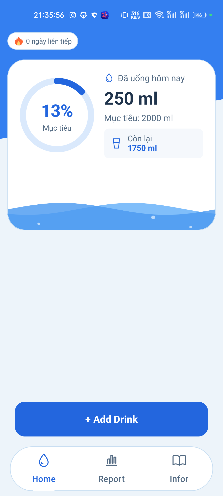
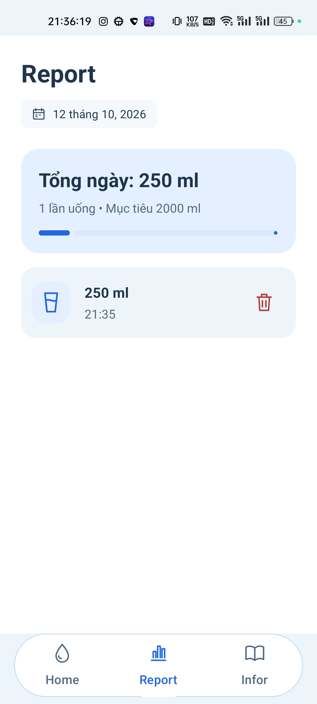
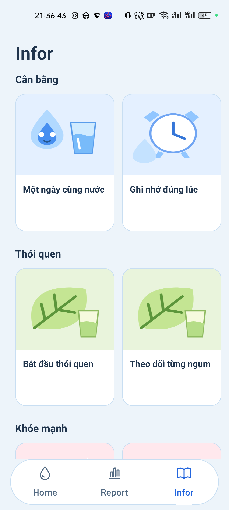

# AquaDaily

**AquaDaily** là ứng dụng Android giúp người dùng ghi lại lượng nước đã uống, theo dõi mục tiêu mỗi ngày và duy trì thói quen uống nước đều đặn. Ứng dụng hiển thị tiến độ bằng hiệu ứng sóng nước, lưu lịch sử trên thiết bị và cung cấp các bài viết ngắn về thói quen uống nước.

Project thực hành phát triển Android với Kotlin, giao diện XML, kiến trúc MVVM và cơ sở dữ liệu Room.

## Giao diện ứng dụng

Ảnh chụp thực tế trên điện thoại realme RMX3350 chạy Android 13. Dữ liệu 250 ml trong ảnh được tạo để minh họa.

<table>
  <tr>
    <th>Home — Tiến độ trong ngày</th>
    <th>Report — Lịch sử uống nước</th>
    <th>Infor — Kiến thức và thói quen</th>
  </tr>
  <tr>
    <td></td>
    <td></td>
    <td></td>
  </tr>
</table>

## Video demo

[Xem video demo AquaDaily](docs/videos/aquadaily-demo.mp4)

Video quay trực tiếp trên thiết bị, dài khoảng **43 giây**, không có âm thanh, giới thiệu luồng sử dụng:

1. Mở **Home** và thêm một lần uống **250 ml**.
2. Xem lượng nước đã uống, tiến độ và hiệu ứng sóng nước cập nhật.
3. Chuyển sang **Report** để xem bản ghi vừa thêm.
4. Mở **Infor** và xem nội dung một bài viết.

## Tính năng

### Home — Theo dõi lượng nước trong ngày

- Hiển thị tổng lượng nước đã uống, mục tiêu, lượng còn thiếu và phần trăm hoàn thành.
- Thêm lần uống bằng các mức chọn nhanh **150 ml, 250 ml, 500 ml** hoặc nhập số lượng riêng từ **1 đến 5.000 ml**.
- Chỉnh mục tiêu từ **250 đến 10.000 ml**; mục tiêu mặc định của ứng dụng là **2.000 ml**.
- Mục tiêu mới áp dụng cho hôm nay và được kế thừa vào những ngày tiếp theo nếu chưa đặt mục tiêu khác.
- Hiển thị chuỗi ngày đạt mục tiêu liên tiếp (streak).
- Minh họa tiến độ bằng sóng nước và vòng tròn tiến độ.

### Report — Lịch sử theo ngày

- Chọn ngày trên lịch để xem các lần uống đã ghi nhận.
- Hiển thị tổng lượng nước, số lần uống, mục tiêu và tiến độ của ngày được chọn.
- Xem lượng nước và thời gian của từng lần uống.
- Xóa bản ghi sau khi xác nhận; tổng lượng nước được cập nhật theo dữ liệu mới.

### Infor — Kiến thức và thói quen

- Đọc **9 bài viết** thuộc ba chuyên mục: **Cân bằng**, **Thói quen** và **Khỏe mạnh**.
- Xem nội dung chi tiết trong hộp thoại cùng hình minh họa.
- Nội dung bài viết được đóng gói sẵn trong ứng dụng, có thể đọc ngoại tuyến.

### Giao diện và lưu trữ

- Điều hướng giữa ba màn hình bằng tab và thao tác vuốt.
- Hỗ trợ giao diện sáng/tối và xử lý khoảng cách với thanh hệ thống.
- Lưu mục tiêu và lịch sử bằng Room trên thiết bị, sử dụng ứng dụng không cần đăng nhập hay kết nối mạng.

## Công nghệ sử dụng

| Thành phần | Công nghệ |
| --- | --- |
| Ngôn ngữ | Kotlin |
| Giao diện | XML Layout, View Binding, Material Components, ConstraintLayout |
| Điều hướng | Single Activity, Fragment, ViewPager2, TabLayout |
| Quản lý trạng thái | ViewModel, SavedStateHandle, StateFlow |
| Xử lý bất đồng bộ | Kotlin Coroutines, Flow |
| Lưu dữ liệu | Room, SQLite |
| Sinh mã cho Room | KSP |
| Hiệu ứng tiến độ | Custom View: WaveView, GoalProgressView |
| Công cụ build | Gradle Wrapper 9.4.1, Android Gradle Plugin 9.1.1 |

Các phiên bản thư viện được quản lý tập trung trong `gradle/libs.versions.toml`.

## Kiến trúc và cấu trúc thư mục

Ứng dụng tổ chức theo MVVM: Fragment hiển thị giao diện và nhận thao tác; ViewModel quản lý trạng thái; Repository làm việc với Room thông qua DAO. Lớp `HydrationMath` chứa các phép tính tiến độ, lượng nước còn thiếu, chuỗi ngày và kiểm tra dữ liệu nhập.

```text
AquaDaily/
├── app/
│   ├── src/main/
│   │   ├── java/com/example/aquadaily/
│   │   │   ├── AquaDailyApp.kt        # Khởi tạo database và repository
│   │   │   ├── MainActivity.kt        # Điều hướng giữa ba tab
│   │   │   ├── data/                  # Entity, DAO, database, repository
│   │   │   ├── domain/                # Tính toán và kiểm tra dữ liệu
│   │   │   └── ui/
│   │   │       ├── home/              # Ghi nhận lượng nước và mục tiêu
│   │   │       ├── report/            # Lịch sử theo ngày
│   │   │       ├── infor/             # Danh mục và nội dung bài viết
│   │   │       └── widgets/           # Các View tùy chỉnh
│   │   ├── res/                       # Layout, màu sắc, chuỗi, hình ảnh
│   │   └── AndroidManifest.xml
│   ├── src/test/                      # Unit test
│   ├── src/androidTest/               # Test chạy trên thiết bị
│   └── build.gradle.kts
├── gradle/
│   ├── libs.versions.toml
│   └── gradle-daemon-jvm.properties   # Yêu cầu JetBrains JDK 21
├── build.gradle.kts
└── settings.gradle.kts
```

## Cài đặt và chạy

### Yêu cầu môi trường

- Android Studio hỗ trợ **Android Gradle Plugin 9.1.1**.
- **JetBrains JDK 21** đầy đủ, có công cụ `jlink`; có thể sử dụng JDK đi kèm Android Studio.
- Android SDK Platform **36.1** theo cấu hình `compileSdk` và SDK Build-Tools tương ứng.
- Thiết bị thật hoặc máy ảo chạy **Android 12 (API 31)** trở lên.
- Kết nối mạng khi tải Gradle, SDK và các thư viện lần đầu.

Ứng dụng có `minSdk = 31`, `targetSdk = 36` và phiên bản `1.0`. JDK dùng để chạy Gradle là Java 21; mức tương thích mã nguồn và bytecode Java trong module hiện được đặt là Java 11.

### Chạy bằng Android Studio

1. Chọn **Open** và mở thư mục `AquaDaily` chứa `settings.gradle.kts`.
2. Cài các SDK còn thiếu qua **SDK Manager** nếu Android Studio yêu cầu.
3. Kiểm tra đường dẫn SDK trong `local.properties` phù hợp với máy đang sử dụng; không sao chép đường dẫn của máy khác.
4. Chọn **Sync Project with Gradle Files** và chờ đồng bộ hoàn tất.
5. Chọn cấu hình **app**, chọn thiết bị hoặc máy ảo, rồi nhấn **Run**.

### Build bằng dòng lệnh

Mở PowerShell tại thư mục `AquaDaily` và chạy:

```powershell
.\gradlew.bat :app:assembleDebug
```

APK debug được tạo tại `app/build/outputs/apk/debug/app-debug.apk`.

## Cách sử dụng

1. Tại **Home**, chạm vào khu vực hiển thị lượng nước còn lại để chỉnh mục tiêu nếu cần.
2. Sau mỗi lần uống, nhấn **Add Drink**, chọn hoặc nhập lượng nước, rồi nhấn **Lưu**.
3. Theo dõi tiến độ và số ngày đạt mục tiêu liên tiếp tại Home.
4. Mở **Report** để chọn ngày, xem lịch sử hoặc xóa bản ghi nhập nhầm.
5. Mở **Infor** và chọn bài viết để đọc nội dung chi tiết.

## Kiểm thử

Project hiện có hai test mẫu: kiểm tra phép cộng trong unit test và kiểm tra package ứng dụng trên thiết bị. Các test này chưa bao phủ nghiệp vụ uống nước.

```powershell
# Chạy unit test trên máy phát triển
.\gradlew.bat :app:testDebugUnitTest

# Chạy instrumented test khi đã kết nối thiết bị hoặc bật máy ảo
.\gradlew.bat :app:connectedDebugAndroidTest
```
## Hướng phát triển

Các ý tưởng có thể bổ sung trong tương lai:

- Nhắc uống nước bằng thông báo theo lịch.
- Biểu đồ thống kê theo tuần và tháng.
- Xuất lịch sử uống nước để người dùng lưu hoặc chia sẻ.
- Bổ sung test cho tính toán tiến độ, chuỗi ngày, lưu dữ liệu và các thao tác chính.
