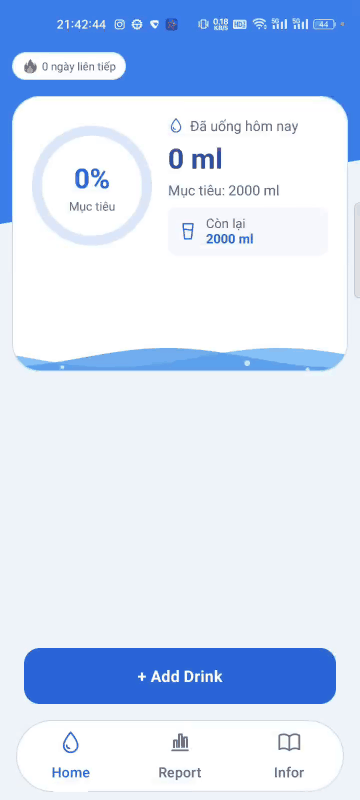

# AndroidTrainingWeek2

Repository tổng hợp các project thực hành Android. **AquaDaily** là ứng dụng theo dõi lượng nước uống hằng ngày, được xây dựng bằng Kotlin, giao diện XML và kiến trúc MVVM.

## AquaDaily

AquaDaily giúp người dùng ghi lại từng lần uống nước, theo dõi tiến độ so với mục tiêu và xem lại lịch sử theo ngày. Dữ liệu được lưu trên thiết bị bằng Room; ứng dụng hoạt động ngoại tuyến và không cần đăng nhập.

### Tính năng chính

- **Home:** thêm lượng nước đã uống, chỉnh mục tiêu, xem tiến độ qua hiệu ứng sóng nước và theo dõi chuỗi ngày đạt mục tiêu.
- **Report:** chọn ngày xem lịch sử, kiểm tra lượng nước và thời gian của từng lần uống, xóa bản ghi nhập nhầm.
- **Infor:** đọc 9 bài viết thuộc các chuyên mục Cân bằng, Thói quen và Khỏe mạnh.
- Hỗ trợ giao diện sáng/tối và điều hướng bằng tab hoặc thao tác vuốt.

### Giao diện ứng dụng

Ảnh chụp thực tế trên điện thoại realme RMX3350 chạy Android 13. Dữ liệu 250 ml trong ảnh được tạo để minh họa.

<table>
  <tr>
    <th>Home — Tiến độ trong ngày</th>
    <th>Report — Lịch sử uống nước</th>
    <th>Infor — Kiến thức và thói quen</th>
  </tr>
  <tr>
    <td></td>
    <td></td>
    <td></td>
  </tr>
</table>

### Video demo



Demo dạng GIF tự chạy trực tiếp trong README. [Tải video MP4 đầy đủ](AquaDaily/docs/videos/aquadaily-demo.mp4?raw=true).

Video dài khoảng **43 giây**, không có âm thanh, minh họa thao tác **thêm nước, chỉnh mục tiêu và theo dõi tiến độ cập nhật** trên thiết bị thật.

### Công nghệ

| Thành phần | Công nghệ |
| --- | --- |
| Ngôn ngữ và giao diện | Kotlin, XML Layout, View Binding, Material Components |
| Kiến trúc và trạng thái | MVVM, ViewModel, SavedStateHandle, StateFlow |
| Điều hướng và danh sách | Fragment, ViewPager2, TabLayout, RecyclerView |
| Lưu trữ và bất đồng bộ | Room, KSP, Kotlin Coroutines, Flow |
| Giao diện tiến độ | Custom View: WaveView, GoalProgressView |

### Kiến thức từ bài giảng đã áp dụng

Các nội dung dưới đây được đối chiếu với mã nguồn AquaDaily hiện tại. Mỗi phần liên kết đến bài giảng và các file minh họa để có thể học lý thuyết cùng với cách triển khai trong ứng dụng.

#### 1. View và ViewGroup

Bài giảng: [View và ViewGroup](BAI_GIANG_VIEW_VIEWGROUP_INTERN.md).

- **Xây dựng cây giao diện bằng XML:** dùng `LinearLayout` để xếp nội dung, `FrameLayout` để chồng các lớp giao diện và `NestedScrollView` cho nội dung cuộn. Trong `activity_main.xml`, `ViewPager2` dùng chiều cao `0dp` kết hợp `layout_weight="1"` để chiếm phần không gian còn lại phía trên thanh tab.
- **Custom View và quá trình đo/vẽ:** `GoalProgressView` và `WaveView` kế thừa `View`, nhận `Context`/`AttributeSet` để dùng trong XML, override `onMeasure()` và dùng `resolveSize()`/`setMeasuredDimension()`. `GoalProgressView` tính lại vùng vẽ trong `onSizeChanged()`; `onDraw()` sử dụng `Canvas`, `Paint`, `RectF` và `Path` để vẽ vòng tiến độ, chữ, sóng nước và bong bóng.
- **Cập nhật hình vẽ và quản lý tài nguyên:** tạo các đối tượng `Paint`/`Path` để dùng lại; gọi `invalidate()` khi tiến độ hoặc frame animation thay đổi. `WaveView` phối hợp trạng thái attach, visibility và `onResume()`/`onPause()` của Home để điều khiển animation, hủy animator khi View bị detach.
- **Phân phối sự kiện chạm:** `NestedScrollableHost` kế thừa `FrameLayout`, xử lý `DOWN`, `MOVE`, `UP`, `CANCEL` trong `onInterceptTouchEvent()`, dùng touch slop và `requestDisallowInterceptTouchEvent()` để phối hợp vuốt ngang giữa danh sách bài viết và pager.
- **Resource theo cấu hình và drawable:** có `layout-land/fragment_report.xml` cho màn hình ngang, `values-w600dp/dimens.xml` cho cửa sổ rộng và `values-night` cho giao diện tối. Nền gradient, nền bo góc và icon được khai báo bằng drawable XML; kích thước giao diện dùng `dp`, chữ dùng `sp`.

Mã nguồn minh họa: [GoalProgressView.kt](AquaDaily/app/src/main/java/com/example/aquadaily/ui/widgets/GoalProgressView.kt), [WaveView.kt](AquaDaily/app/src/main/java/com/example/aquadaily/ui/widgets/WaveView.kt), [NestedScrollableHost.kt](AquaDaily/app/src/main/java/com/example/aquadaily/ui/widgets/NestedScrollableHost.kt), [activity_main.xml](AquaDaily/app/src/main/res/layout/activity_main.xml), [res/](AquaDaily/app/src/main/res/).

#### 2. Fragment và DialogFragment

Bài giảng: [Fragment và DialogFragment](BAI_GIANG_FRAGMENT_DIALOGFRAGMENT_INTERN.md).

- **Tách màn hình thành Fragment:** `HomeFragment`, `ReportFragment` và `InforFragment` đảm nhiệm ba màn hình trong một Activity. Mỗi Fragment thiết lập giao diện ở `onViewCreated()` và giải phóng tham chiếu binding, adapter phù hợp trong `onDestroyView()`.
- **Chọn đúng FragmentManager:** dialog thuộc màn hình được mở bằng `childFragmentManager`. Trước khi mở, kiểm tra `isStateSaved` và `findFragmentByTag()`; dùng `showNow()` để thêm dialog ngay và hạn chế mở trùng khi bấm liên tiếp.
- **Tạo hộp thoại theo chức năng:** `AmountDialogFragment` nhập lượng nước hoặc mục tiêu; `CalendarDialogFragment` chọn ngày; `DeleteDrinkDialogFragment` xác nhận xóa; `ArticleDialogFragment` hiển thị bài viết. Các dialog tạo UI qua `onCreateDialog()`, dùng `MaterialAlertDialogBuilder` hoặc `DatePickerDialog`.
- **Truyền đầu vào và trả kết quả:** các hàm `newInstance()` đặt dữ liệu vào `arguments` bằng `Bundle`. Dialog gửi lượng nước, ngày hoặc ID bản ghi qua `parentFragmentManager.setFragmentResult()`; Fragment cha nhận trên cùng manager bằng `setFragmentResultListener(..., viewLifecycleOwner)` rồi gọi action của ViewModel.
- **Giữ trạng thái và kiểm tra dữ liệu:** dialog nhập nước lưu nội dung đang nhập, dialog lịch lưu ngày đang chọn bằng `onSaveInstanceState()`. Nút Lưu của dialog nhập nước được gắn listener trong `onStart()` để hiển thị lỗi và giữ hộp thoại mở khi giá trị chưa hợp lệ.

Mã nguồn minh họa: [HomeFragment.kt](AquaDaily/app/src/main/java/com/example/aquadaily/ui/home/HomeFragment.kt), [AmountDialogFragment.kt](AquaDaily/app/src/main/java/com/example/aquadaily/ui/home/AmountDialogFragment.kt), [CalendarDialogFragment.kt](AquaDaily/app/src/main/java/com/example/aquadaily/ui/report/CalendarDialogFragment.kt), [DeleteDrinkDialogFragment.kt](AquaDaily/app/src/main/java/com/example/aquadaily/ui/report/DeleteDrinkDialogFragment.kt), [ArticleDialogFragment.kt](AquaDaily/app/src/main/java/com/example/aquadaily/ui/infor/ArticleDialogFragment.kt).

#### 3. RecyclerView

Bài giảng: [RecyclerView](BAI_GIANG_RECYCLERVIEW_INTERN.md).

- **Adapter, ViewHolder và LayoutManager:** Report dùng `DrinkHistoryAdapter` với `LinearLayoutManager` để hiển thị lịch sử uống nước. ViewHolder giữ binding của item; `onCreateViewHolder()` inflate layout, `onBindViewHolder()` gán dữ liệu và listener cho item hiện tại.
- **Cập nhật danh sách bằng ListAdapter/DiffUtil:** các adapter gọi `submitList()`, so sánh identity bằng ID trong `areItemsTheSame()` và so sánh nội dung trong `areContentsTheSame()`. Sự kiện xóa/đọc bài viết truyền đối tượng hoặc ID của dữ liệu được bind.
- **Danh sách dọc chứa danh sách ngang:** Infor dùng `InfoSectionAdapter` cho các chuyên mục dọc, mỗi ViewHolder chứa một `ArticleAdapter` và `LinearLayoutManager` ngang. Adapter và LayoutManager con được tạo một lần trong holder; các danh sách con dùng chung `RecycledViewPool` và cấu hình prefetch.
- **Bind đúng khi tái sử dụng holder:** `ArticleAdapter` gán lại chữ, hình minh họa, màu nền, mô tả accessibility và click listener mỗi lần bind, kể cả khi holder được chuyển qua danh sách con khác nhờ shared pool.
- **Khôi phục vị trí cuộn:** lưu state của LayoutManager theo ID chuyên mục trong `InforViewModel`/`SavedStateHandle`, khôi phục sau khi danh sách con được submit. `InfoSectionAdapter` lưu state khi holder bị detach/recycle; adapter chuyên mục và lịch sử dùng `PREVENT_WHEN_EMPTY` để chờ dữ liệu trước khi phục hồi state.

Mã nguồn minh họa: [DrinkHistoryAdapter.kt](AquaDaily/app/src/main/java/com/example/aquadaily/ui/report/DrinkHistoryAdapter.kt), [InfoSectionAdapter.kt](AquaDaily/app/src/main/java/com/example/aquadaily/ui/infor/InfoSectionAdapter.kt), [ArticleAdapter.kt](AquaDaily/app/src/main/java/com/example/aquadaily/ui/infor/ArticleAdapter.kt), [InforViewModel.kt](AquaDaily/app/src/main/java/com/example/aquadaily/ui/infor/InforViewModel.kt).

#### 4. ViewPager2 và TabLayout

Bài giảng: [ViewPager, ViewPager2 và TabLayout](BAI_GIANG_VIEWPAGER_TABLAYOUT_INTERN.md).

- **Pager chứa các trang Fragment:** `MainActivity` cung cấp `FragmentStateAdapter(this)` với `getItemCount() = 3`; `createFragment()` ánh xạ vị trí `0`, `1`, `2` sang Home, Report, Infor.
- **Đồng bộ tab với trang:** gán adapter trước, tạo `TabLayoutMediator` rồi gọi `attach()`. Mediator gắn nhãn/icon cho từng tab và đồng bộ thao tác chọn tab với thao tác vuốt trang.
- **Chuyển trang và xử lý callback:** `goHome()` gọi `setCurrentItem(0, true)`. `OnPageChangeCallback.onPageSelected()` cập nhật giao diện thanh hệ thống và bật xử lý Back khi ở Report/Infor để đưa người dùng về Home.
- **Tùy biến tab và dọn dẹp:** layout cấu hình tab cố định, màu chữ/icon theo trạng thái, ripple và nền bo góc. `onDestroy()` gọi `mediator.detach()`, gỡ page callback và xóa adapter của pager.
- **Phối hợp cử chỉ cùng hướng:** các dải bài viết ngang được bọc trong `NestedScrollableHost`; ưu tiên cuộn danh sách khi còn cuộn được theo hướng vuốt, nhường gesture cho pager khi chạm biên.

Mã nguồn minh họa: [MainActivity.kt](AquaDaily/app/src/main/java/com/example/aquadaily/MainActivity.kt), [activity_main.xml](AquaDaily/app/src/main/res/layout/activity_main.xml), [tab_tint.xml](AquaDaily/app/src/main/res/color/tab_tint.xml), [item_info_section.xml](AquaDaily/app/src/main/res/layout/item_info_section.xml).

#### 5. Kiến trúc MVVM và quản lý trạng thái

Bài giảng: [Mô hình MVVM](BAI_GIANG_MVVM_INTERN.md).

- **Phân chia trách nhiệm:** Fragment nhận tương tác và render; ViewModel giữ trạng thái, điều phối thao tác; `HydrationRepository` truy cập dữ liệu qua DAO/Room. `HydrationMath` tập trung các phép tính tiến độ, lượng còn thiếu, streak và validation.
- **UI state và action:** `DayUiState` chứa dữ liệu ngày, mục tiêu, lịch sử, streak và các cờ `loading`/`busy`/`error`. UI gọi các hàm `addDrink()`, `setGoal()`, `selectDay()`, `deleteDrink()`, `retry()`; Home và Report render từ `StateFlow` do ViewModel cung cấp.
- **Kết hợp luồng dữ liệu:** dùng `combine` để ghép dữ liệu và trạng thái tác vụ, `map` để chuyển snapshot thành UI state, `flatMapLatest` để đổi luồng quan sát khi ngày thay đổi, `catch` để phát state lỗi. `stateIn(viewModelScope, SharingStarted.WhileSubscribed(5000), ...)` chia sẻ luồng thành StateFlow.
- **Thu thập state theo vòng đời View:** Home và Report dùng `viewLifecycleOwner.lifecycleScope` cùng `repeatOnLifecycle(STARTED)` để thu thập state khi View đang hoạt động và render lại khi quay về màn hình.
- **Coroutine và xử lý lỗi:** `ActionViewModel` chạy thao tác ghi bằng `viewModelScope.launch`, dùng `Mutex` để tuần tự hóa các thao tác trong ViewModel, cập nhật trạng thái bận/lỗi và ném lại `CancellationException` để giữ cơ chế hủy coroutine.
- **Scope, dependency và saved state:** các Fragment lấy ViewModel bằng `by viewModels`; factory truyền repository qua constructor và tạo `SavedStateHandle`. Report lưu ngày đang chọn; Infor lưu vị trí cuộn. Dữ liệu uống nước và mục tiêu được lưu bền vững trong Room.

Mã nguồn minh họa: [HomeViewModel.kt](AquaDaily/app/src/main/java/com/example/aquadaily/ui/home/HomeViewModel.kt), [ReportViewModel.kt](AquaDaily/app/src/main/java/com/example/aquadaily/ui/report/ReportViewModel.kt), [DayUiState.kt](AquaDaily/app/src/main/java/com/example/aquadaily/ui/DayUiState.kt), [ActionViewModel.kt](AquaDaily/app/src/main/java/com/example/aquadaily/ui/ActionViewModel.kt), [ViewModelFactories.kt](AquaDaily/app/src/main/java/com/example/aquadaily/ui/ViewModelFactories.kt), [HydrationMath.kt](AquaDaily/app/src/main/java/com/example/aquadaily/domain/HydrationMath.kt).

#### 6. Data Storage: Room, SQL và quan sát dữ liệu

Bài giảng: [Data Storage](BAI_GIANG_DATA_STORAGE_INTERN.md).

- **Thiết kế Entity/DAO/Database:** `DrinkEntry` lưu mỗi lần uống nước với khóa chính tự sinh và index trên `dayEpoch`, `timestamp`; `DailyGoal` dùng ngày làm khóa chính. `HydrationDatabase` khai báo hai entity, schema version 1 và khởi tạo database singleton bằng application context.
- **Thêm, đọc, cập nhật, xóa:** DAO dùng `@Insert` để thêm lần uống, `@Upsert` để lưu/cập nhật mục tiêu, `@Query` để đọc dữ liệu và xóa theo ID. Các thao tác ghi/đọc một lần dùng hàm `suspend`; truy vấn nhận tham số bind như `:day`, `:id`.
- **Transaction và kiểm tra đầu vào:** repository kiểm tra lượng nước/mục tiêu trước khi lưu. `withTransaction` bao bọc việc bảo đảm ngày có mục tiêu và thêm bản ghi uống nước, giúp các bước này được thực hiện cùng một transaction. Ngày mới kế thừa mục tiêu gần nhất hoặc dùng mục tiêu mặc định.
- **Lọc, sắp xếp và thống kê bằng SQL:** lọc lịch sử theo ngày; `ORDER BY timestamp DESC, id DESC` đưa bản ghi mới lên trước với thứ tự xác định khi trùng thời gian. Truy vấn ngày đạt mục tiêu dùng `INNER JOIN`, `GROUP BY`, `SUM` và `HAVING` để cung cấp dữ liệu tính streak.
- **Observable query bằng Flow:** DAO trả `Flow` cho mục tiêu, lịch sử và ngày hoàn thành. Repository dùng `combine` để tạo `DaySnapshot`, `distinctUntilChanged` để bỏ các kết quả liên tiếp bằng nhau. Khi dữ liệu Room thay đổi, luồng state cập nhật tổng lượng nước và lịch sử trên UI.
- **Sinh mã và xuất schema:** module bật KSP, khai báo `room-compiler` trong `ksp(...)`, cấu hình `room.schemaLocation`; database bật `exportSchema = true`. Schema phiên bản 1 được lưu trong repository để theo dõi cấu trúc database.

Mã nguồn minh họa: [DrinkEntry.kt](AquaDaily/app/src/main/java/com/example/aquadaily/data/DrinkEntry.kt), [DailyGoal.kt](AquaDaily/app/src/main/java/com/example/aquadaily/data/DailyGoal.kt), [HydrationDao.kt](AquaDaily/app/src/main/java/com/example/aquadaily/data/HydrationDao.kt), [HydrationDatabase.kt](AquaDaily/app/src/main/java/com/example/aquadaily/data/HydrationDatabase.kt), [HydrationRepository.kt](AquaDaily/app/src/main/java/com/example/aquadaily/data/HydrationRepository.kt), [app/build.gradle.kts](AquaDaily/app/build.gradle.kts), [schema phiên bản 1](AquaDaily/app/schemas/com.example.aquadaily.data.HydrationDatabase/1.json).

#### Ví dụ tổng hợp: luồng thêm một lần uống nước

```text
Home mở AmountDialogFragment → kiểm tra lượng nước → gửi Fragment Result
→ HomeViewModel.addDrink() → HydrationRepository.addDrink()
→ Room transaction: bảo đảm mục tiêu ngày + chèn DrinkEntry
→ DAO Flow phát dữ liệu → ViewModel cập nhật DayUiState
→ Fragment render tổng lượng nước, tiến độ và danh sách lịch sử
```

Luồng này kết hợp dialog, giao tiếp Fragment, MVVM, coroutine, Room/Flow, RecyclerView và Custom View: Home cập nhật vòng tiến độ/sóng nước, còn Report cập nhật danh sách khi đang quan sát ngày tương ứng.

### Chạy project

1. Mở thư mục **AquaDaily** bằng Android Studio hỗ trợ Android Gradle Plugin **9.1.1**.
2. Chuẩn bị **JetBrains JDK 21**, Android SDK Platform **36.1** và đồng bộ Gradle.
3. Chọn thiết bị hoặc máy ảo chạy **Android 12 (API 31)** trở lên, rồi nhấn **Run**.

Để build APK bằng PowerShell từ thư mục gốc repository:

```powershell
cd AquaDaily
.\gradlew.bat :app:assembleDebug
```

Xem [README chi tiết của AquaDaily](AquaDaily/README.md) để biết cấu trúc mã nguồn, cách sử dụng, lệnh kiểm thử và cách xử lý lỗi JDK / `jlink`.

## Các project thực hành khác

- [DayOne](DayOne/)
- [DayTwo](DayTwo/)
- [DayFour](DayFour/)
- [DayFive](DayFive/)
- [DaySix](DaySix/)
